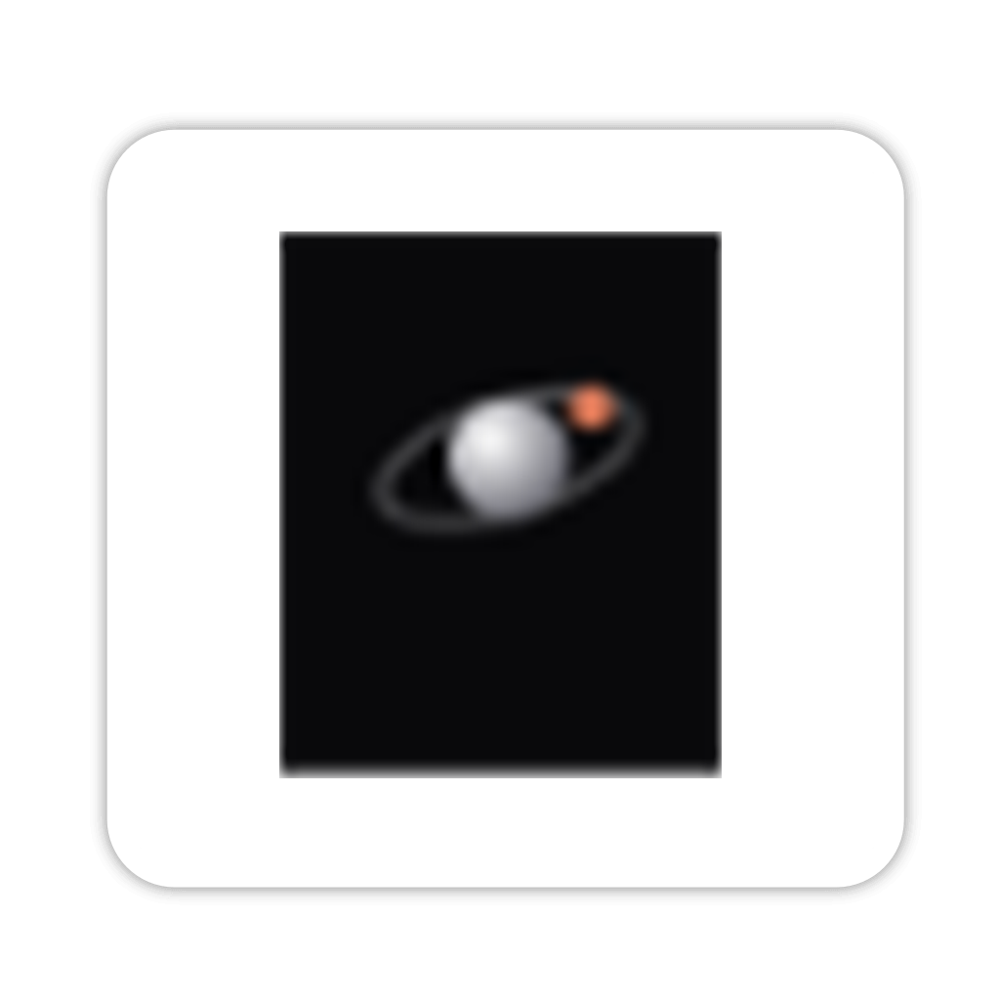

<p align="center">
  
</p>

# Orbit

> **One galaxy per project. One planet per agent.**  
> A Wails v3 desktop app that orchestrates coding agents — Claude Code, Codex, Oh My Pi, OpenCode, Fx and Pi — inside your git repositories. It comes with a built-in terminal, diff review, conflict detection, a native browser, scheduled automations and agents that can talk to each other.

## ✨ Features

### Galaxy and agents

- 🪐 **Galaxy view** — every project is a sun and every agent a planet orbiting it. Pan, zoom and pick a project at a glance.
- 🤖 **Six providers** — Claude Code and Codex are the main ones; Oh My Pi, OpenCode, Fx and Pi are also supported. Each provider is detected on your `PATH`, and the launch dialog shows which are installed.
- 🧭 **Agent inspector** — overview, chat, activity, files, tools, issues and Git tabs for each agent.
- 🔀 **Change things mid-session** — switch an agent's model, thinking level, permissions, branch, or repository from the chat footer. A repository change starts a fresh session there.
- ⚡ **Speed dropdown** — Standard, Fast and Ultrafast, in the chat footer and the launch dialog. Fast shows white streaks running right. Ultrafast appears only where the signed-in Codex account offers it, detected from the CLI's own models cache.

### Working in a repo

- 🌿 **Per-agent worktrees** — launch an agent on its own branch and worktree, or share a worktree with an agent that is already running. Branches and worktrees are listed in the launch dialog.
- 📝 **Diff & commit** — review per-file diffs, stage what you want, and commit from the Changes tab. No leaving the app.
- ⚠️ **Conflict radar** — detects when two agents touch the same file before you merge.
- 🖥️ **Embedded terminal** — a real PTY shell (ConPTY on Windows) rooted in the project.
- 🌐 **Native browser** — a WebView2 page view on Windows, plus a text-mode `browse_page` MCP tool that agents can call. Pages are cached.

### Coordination

- 💬 **Talk** — start a conversation between two agents, or a team of several, with a topic and a turn limit. Agents reply in turn, and you can stop a conversation at any point.
- 🤝 **Pairing and handoffs** — pair an agent with a partner, or hand a task from one agent to another in the same project.
- ⏰ **Automations** — schedule an agent to launch a task on set days and times, from the Automations dialog.

### Settings and everyday use

- 🔐 **SSH connections** — save SSH connections in Settings › SSH, with password, key or SSH-agent sign-in. You can test each one and remove it. *Connections are stored and tested, but terminals and agents do not connect through them yet.*
- 🔄 **In-app release check** — Settings › Release tells you when a newer Orbit is out.
- 💾 **One-file state** — everything persists as a single versioned JSON file, easy to back up or move.
- ⌨️ **Keyboard-first** — the full shortcut map is shown in Settings › Keyboard.

## 🚀 Quick start

```bash
# Prerequisites: Go, Node.js, npm, Git, Wails v3 CLI
# plus the agent CLIs you want (claude, codex, ...) on PATH

git clone https://github.com/ByteTheDev/Orbit.git
cd Orbit
wails3 dev -config build/config.yml
```

Open the dev server at `http://localhost:34115` to call Go methods from devtools, or use the app window directly.

## 📦 Install a release

Installers for Windows, macOS and Linux are attached to each [GitHub release](https://github.com/ByteTheDev/Orbit/releases). The release workflow builds them when a `v*` tag is pushed.

## 🛠️ Build

```bash
# Production build
wails3 build

# Output: bin/Orbit (or Orbit.exe on Windows)
```

Platform notes:

- **Windows** — full feature set, including the native browser view.
- **macOS / Linux** — build on the target OS with Go, Node, npm, Git, and Wails v3. The terminal uses `$SHELL` (falling back to `/bin/sh`), and the native browser view falls back to the text view. Desktop runtime behaviour on these platforms still needs verification.

Install and sign in to the agent CLIs separately, and make sure they are on the `PATH` available to Orbit when it launches.

## 🧪 Development

```bash
# Go tests (add -short to skip the ConPTY shell test)
go test ./...

# Frontend tests and typecheck
cd frontend && npm test
cd frontend && npm run typecheck
```

## 🗂️ Project layout

```
Orbit/
├── main.go                 # Wails entrypoint
├── app.go                  # Bound App methods
├── internal/
│   ├── agent/              # Projects, agents, turns, talk, automations, worktrees, event batching
│   ├── browser/            # Page fetch, cache and browse_page MCP server
│   ├── conflict/           # Cross-agent file conflict detection
│   ├── gitdiff/            # Diff, status, stage, commit, worktrees
│   ├── model/              # Shared data types
│   ├── provider/           # Claude Code, Codex, Oh My Pi, OpenCode, Fx and Pi adapters
│   ├── ssh/                # SSH connection profiles: dial, test, run
│   ├── store/              # Single-file persistence
│   ├── terminal/           # PTY shells
│   └── webpane/            # Native page view (Windows)
└── frontend/               # React + TypeScript (Vite)
    └── src/
        ├── lib/            # Pure logic, store, bridge, actions
        └── components/     # UI: galaxy, inspector, dialogs, automations, settings
```

## 📡 Backend ↔ frontend contract

- The frontend calls Go through `frontend/src/lib/bridge.ts`. The generated bindings in `frontend/bindings/` are not edited by hand.
- Go pushes updates on the `orbit:events` channel. Terminals use `terminal:output` and `terminal:exit`.
- Empty collections serialize as `[]`, never `null`.

## 🤝 Contributing

Issues and PRs welcome. Keep pure logic in `lib/` and `internal/` free of React and Wails so it stays unit-testable, and route user-facing failures through toasts in `actions.ts`.

---

Built with [Wails v3](https://wails.io) · [React](https://react.dev) · [TypeScript](https://www.typescriptlang.org) · [Vite](https://vitejs.dev)
